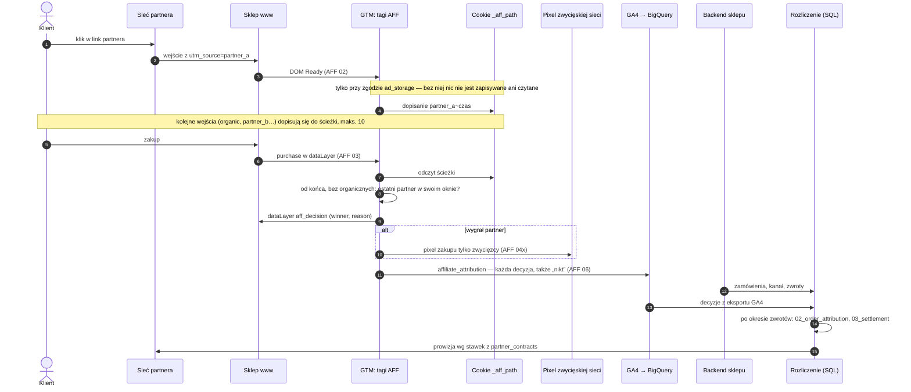

# Diagram sekwencji UML: wejścia partnerów → decyzja → rozliczenie

Jak jedno zamówienie dostaje co najwyżej jednego partnera i jak z tego powstaje prowizja. Opis tagów i reguł: [README](README.md).

| Krok | Kto | Po co |
|---|---|---|
| 1–4 | tag GTM | ścieżka wejść zapisana na urządzeniu, tylko za zgodą |
| 5–10 | tag GTM | pixel dostaje jedna sieć, więc zamówienie nie jest opłacane dwa razy |
| 11 | tag GTM → GA4 | decyzja trafia do BigQuery, także gdy nikt nie wygrał |
| 12–15 | data engineer / finanse | prowizja z backendu, bo tylko on zna zwroty |
